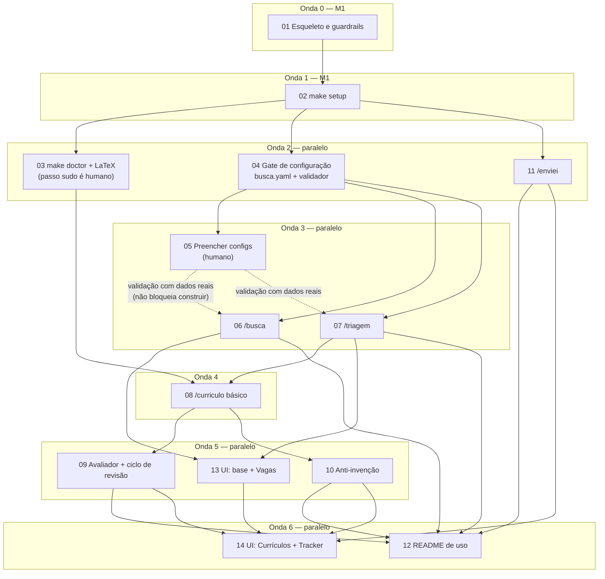

# Fluxo e paralelismo dos tickets

Setas apontam de um ticket para o que ele desbloqueia. Tickets na mesma "onda" não dependem entre si e **podem rodar em paralelo** (agentes ou worktrees separados).

## Tabela de ondas

| Onda | Tickets | Paralelo? | Observação |
|---|---|---|---|
| 0 | 01 | não | Ponto de partida. |
| 1 | 02 | não | Traz upstream e dados; todos os outros dependem disso. |
| 2 | 03, 04, 11 | **sim (3)** | Independentes entre si. O 03 tem um passo humano (`sudo apt`). |
| 3 | 05, 06, 07 | **sim (3)** | O 05 é humano e roda em paralelo com a construção de 06/07, que usam um modelo de teste. A validação final de 06/07 com dados reais espera o 05. |
| 4 | 08 | não | Precisa do 03 (LaTeX) e do 07 (triagem). |
| 5 | 09, 10, 13 | **sim (3)** | 09 e 10 mexem no mesmo fluxo do `/curriculo`: combinar a ordem de merge ou usar worktrees. O 13 só depende de 06 e 07, então **pode começar já na onda 4**, em paralelo com o 08. |
| 6 | 12, 14 | **sim (2)** | O 12 é só texto e o 14 é UI; independentes. |

## Caminho crítico

`01 → 02 → 03 → 08 → 09 → 14` (ou `10 → 14`). É o que dita o prazo; o resto cabe nas folgas.

## Folgas úteis

- **11 `/enviei`** pode ser feito a qualquer momento depois do 02, é o ticket mais solto.
- **13 UI base** não precisa esperar o ciclo de revisão: começa assim que 06 e 07 estiverem prontos.
- **05 (humano)** deve ser disparado o quanto antes: é o gargalo fora do controle do agente.
